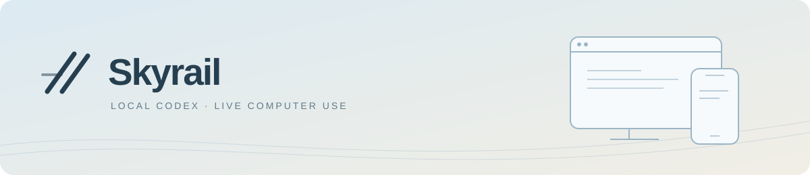
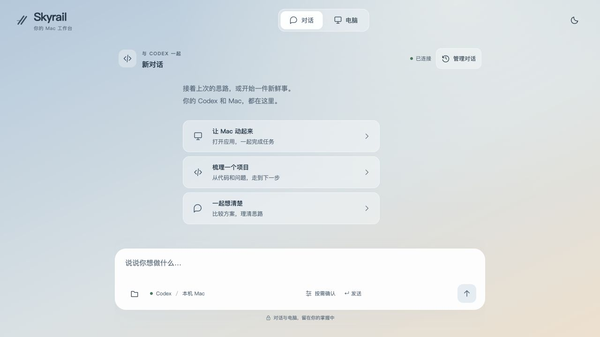

<p align="center">
  <picture>
    <source media="(prefers-color-scheme: dark)" srcset="docs/assets/skyrail-banner-dark.svg">
    
  </picture>
</p>

<h1 align="center">Local Codex. Live Computer Use.</h1>

<p align="center">Self-host on your Mac. Stream to a browser. Let AI act. Take over.</p>

<p align="center"><strong>English</strong> · <a href="README.zh-CN.md">简体中文</a></p>

<p align="center">
  <a href="https://github.com/eminentgu/skyrail/actions/workflows/ci.yml"></a>
  <a href="LICENSE"></a>
  
  
</p>

<p align="center"><a href="#try-it-locally">Quick start</a> · <a href="docs/README.md">Documentation</a> · <a href="docs/GETTING-STARTED.md">Permissions & testing</a> · <a href="https://github.com/eminentgu/skyrail/issues/new/choose">Report an issue</a> · <a href="https://eminentgu.github.io/skyrail/">Documentation website</a></p>

---

**Skyrail is a self-hosted, browser-streamed Computer Use workspace powered by local Codex.** Run Codex and the control service on your own Mac, stream live app or desktop views to a desktop or phone browser, let AI operate applications, and take over yourself. Build your own **Dot / Grok bot / Hark-style experience** around the Codex runtime you already use.

> [!NOTE]
> **Early access · self-hosted · single user.**

<p align="center">
  <picture>
    <source media="(prefers-color-scheme: dark)" srcset="docs/assets/skyrail-desktop-dark.png">
    
  </picture>
</p>

<p align="center"><sub>Actual local interface · The current product UI is in Chinese; documentation is available in English and Chinese.</sub></p>

**[Take a visual tour →](docs/VISUAL-GUIDE.md)**

## From conversation to action

<table>
  <tr>
    <td width="50%" valign="top"><strong>Local Codex Computer Use</strong><br><br>Codex drives execution; native Mac tools connect to real apps. Keep your sessions, files and working directories.</td>
    <td width="50%" valign="top"><strong>A live computer view in your browser</strong><br><br>Stream app views to a desktop or phone browser, with trackpad gestures, zoom and text input.</td>
  </tr>
  <tr>
    <td width="50%" valign="top"><strong>See the work. Step in.</strong><br><br>Watch a selected app; use macOS Screen Sharing to control the whole desktop yourself.</td>
    <td width="50%" valign="top"><strong>Files that follow the task</strong><br><br>Attach uploads or project files and download the results. Upload limit: 50 MiB per file.</td>
  </tr>
  <tr>
    <td width="50%" valign="top"><strong>Your existing Codex</strong><br><br>Use the runtime and account you already have, without a separate agent execution stack.</td>
    <td width="50%" valign="top"><strong>Connect to your own Mac</strong><br><br>A password gateway and your HTTPS tunnel keep the workspace on your machine.</td>
  </tr>
</table>

**Desktop control.** A floating computer button opens a foldable sidebar. A computer tool call from chat opens it automatically on desktop browsers. Maximize the computer when you need the whole workspace. Connect to view, click **Take control** for mouse and keyboard, and press **Esc** to release. The controlled pointer appears inside the video. On phones, the floating button switches between chat and the touch workspace. Screen controls float above the video, and attachments and settings expand from the compact chat composer.

**Web languages and weak connections.** Use the language button in the Web header to switch between English and Chinese. The single-app stream prioritizes current frames and lowers resolution and JPEG quality as delivery slows. Full desktop requests lower JPEG quality from Screen Sharing when available.

**Image chat:** select a picture, paste a screenshot, or drop files into the conversation. Preview before sending and open sent images at a larger size. PNG / JPEG / WebP / GIF reach Codex as native visual input (20 MiB per image; general files remain 50 MiB). [Image help](SUPPORT.md#image-chat).

Skyrail does not include a model subscription or bundle the desktop app’s private computer-use engine.

## Try it locally

Start with the browser interface. **Accessibility, Screen Recording, Screen Sharing, and administrator access are not required to install dependencies, run tests, build the UI, or open it.** Real tasks need an authenticated Codex CLI; desktop features need additional permissions.

Requirements: Node.js 22.12+; macOS 14+ and Xcode Command Line Tools for native features. CI uses Node.js 22. The currently validated Codex CLI is `0.165.0-alpha.1.2`; other versions need compatibility checks.

```sh
git clone https://github.com/eminentgu/skyrail.git
cd skyrail
npm ci
npm run doctor
npm run dev
```

Open **[http://127.0.0.1:4317](http://127.0.0.1:4317)**. Stop the foreground server with Ctrl+C. If Codex is not on PATH, use `CODEX_BIN=/absolute/path/to/codex npm run dev`.

> [!IMPORTANT]
> Before sending your first task, open the composer settings and turn off **Allow all operations** if you want workspace-scoped execution with approvals. Full access is currently the default; it does not grant macOS permissions.

For native app control, build the helper with `npm run setup:mac`, then grant the permissions required for that feature. Enable macOS Screen Sharing separately for manual desktop control. **[Follow the setup and permission guide →](docs/GETTING-STARTED.md)**

## Enable only what you need

| Feature | Additional requirement |
| --- | --- |
| UI, JavaScript tests, frontend build | No macOS privacy permission or model login |
| Real Codex conversations | Installed, authenticated Codex CLI |
| Agent app observation/input | Native helper, Screen Recording and Accessibility |
| Manual full-desktop control | macOS Screen Sharing and your own Mac account login |
| Protected Desktop/Documents folders | Folder access when needed; Full Disk Access is not a general prerequisite |
| Phone access from another device | Password gateway plus your own HTTPS tunnel |

Missing GUI permissions do not prevent chat-only testing. They do prevent validating real screenshots, input, and handover. `npm run doctor` checks prerequisites without requesting permissions, capturing screenshots, or making model calls.

<details>
<summary><strong>How session sync and control handover work</strong></summary>


Confirmed history comes from Codex's durable session records. Skyrail stores UI state, pending sends, and recoverable hidden conversations locally. Use clients alternately: **one session cannot have two concurrent writers**. If another client holds its write lock, release it there first. Synchronizing history does not transfer another client's private tools or system permissions.

Manual full-desktop control uses macOS Screen Sharing/noVNC; agent app control uses Skyrail's own Swift adapter. Sending a task parks manual keyboard/mouse input while retaining the desktop stream. Use **Take over** to resume manual input. This coordinates Skyrail clients, not every program or physical input device on the Mac.


If a session is occupied, inspect its owning connection, review the affected connection count, and explicitly confirm ending it before reconnecting. Other tasks sharing that process also stop; history and drafts remain and are not automatically resent. For stalled files, use the bounded checks in [troubleshooting](SUPPORT.md).

</details>

## Remote access and updates

Keep the local service on loopback. Expose **gateway port 4318**, never the unauthenticated service on 4317. The gateway is single-user, not a multi-user authorization system.

**[Remote access, background service, updates, and removal →](docs/REMOTE-ACCESS.md)**

The managed service serves a fixed frontend build; development uses Vite. Build before installing or restarting the managed service. Native code is ad-hoc signed; rebuilding may invalidate macOS permission grants.

## Current boundaries

- Native functionality requires macOS; Linux CI covers JavaScript tests and frontend builds.
- No stable signing/notarization, automatic installer, or bundled HTTPS tunnel.
- Phone touch simulation does not establish real iOS/Android keyboard compatibility.
- Locking the Mac pauses app capture/input. Manual lock-screen login needs your own authentication and real-device acceptance.
- Active viewing/tasks can keep the system awake; app capture may light the physical display. Headless mode needs a separately validated display setup.
- Codex shell/MCP access is not an OS sandbox. Read [security boundaries](SECURITY.md) before enabling remote or full access.

## Frequently asked questions

### What is browser-streamed Computer Use?

The control service runs on your Mac while a browser receives live app or desktop views and provides the interaction surface. The model observes and operates apps on demand through Skyrail's native tools. Continuous viewing and model screenshots use separate paths; every video frame is not sent to the model. Manual whole-desktop takeover uses macOS Screen Sharing.

### Can I self-host a Dot, Grok bot or Hark-style experience?

Skyrail is for people who want to build a similar combination of AI conversations, a live computer view and human takeover on their own Mac, using local Codex and a browser. These names describe the experience direction, not official integrations or complete feature parity.

### Does local Codex mean an offline model?

Local refers to the Codex runtime, Mac control components and web service running on your own machine. Model requests use your Codex account and configured service; this does not mean offline local inference.

## Explore the docs

**[Open the documentation hub →](docs/README.md)**

| Get started | Go deeper |
| --- | --- |
| [Setup, permissions & staged testing](docs/GETTING-STARTED.md) | [Architecture & control ownership](docs/ARCHITECTURE.md) |
| [Remote access, updates & removal](docs/REMOTE-ACCESS.md) | [Validation records](docs/VALIDATION.md) |
| [Troubleshooting](SUPPORT.md) | [Contributing](CONTRIBUTING.md) · [Maintaining](docs/MAINTAINERS.md) |
| [Security boundaries](SECURITY.md) | [Changelog](CHANGELOG.md) · [Third-party notices](THIRD-PARTY-NOTICES.md) |

### Develop with Skyrail

```sh
npm test
npm run build
npm run setup:mac  # macOS only, after native changes
```

Model smoke scripts are opt-in, use your Codex account, and can incur usage. They do not replace real desktop testing; read the setup guide before running them.

MIT licensed. Dependencies and external services have their own terms. Chinese and English feedback is welcome; support is best effort, without a response-time commitment.
