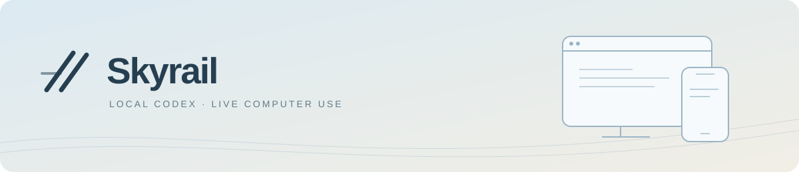
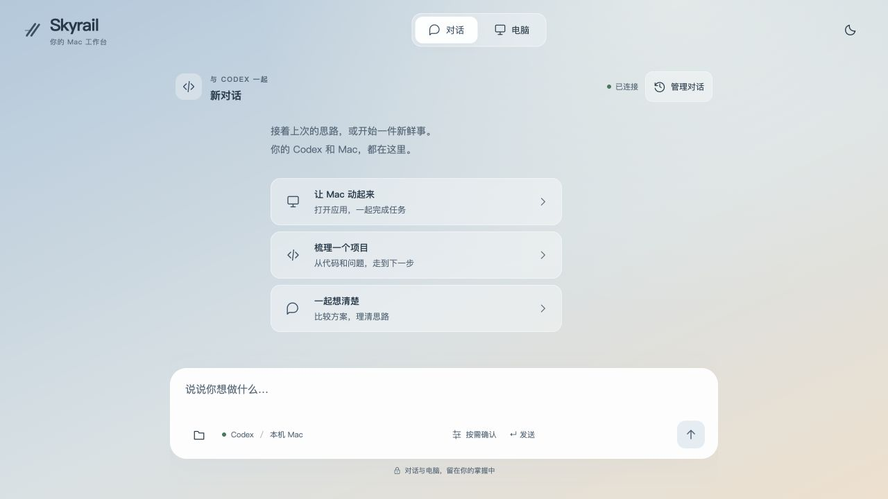

<p align="center">
  <picture>
    <source media="(prefers-color-scheme: dark)" srcset="docs/assets/skyrail-banner-dark.svg">
    
  </picture>
</p>

<h1 align="center">你的 Codex 和 Mac，随时接续。</h1>

<p align="center">继续对话 · 传递文件 · 查看画面 · 人工接手</p>

<p align="center"><a href="README.md">English</a> · <strong>简体中文</strong></p>

<p align="center">
  <a href="https://github.com/eminentgu/skyrail/actions/workflows/ci.yml"></a>
  <a href="LICENSE"></a>
  
  
</p>

<p align="center"><a href="#本地试用">快速开始</a> · <a href="docs/README.zh-CN.md">文档中心</a> · <a href="docs/GETTING-STARTED.zh-CN.md">权限与测试</a> · <a href="https://github.com/eminentgu/skyrail/issues/new/choose">反馈问题</a></p>

---

Skyrail 是面向 Codex 和 Mac 的本地优先网页界面。通过电脑或手机浏览器继续已有会话，在同一处完成对话、文件传递与电脑操作。

> [!NOTE]
> **早期版本 · 自行部署 · 单用户。** 当前不提供托管服务或公证安装包；手机真机、跨应用输入和锁屏登录仍有验收缺口。[查看验证记录](docs/VALIDATION.md)。

<p align="center">
  <picture>
    <source media="(prefers-color-scheme: dark)" srcset="docs/assets/skyrail-desktop-dark.png">
    
  </picture>
</p>

<p align="center"><sub>真实本地界面 · 当前产品界面为中文；文档提供中文与英文。</sub></p>

## 从对话到行动

<table>
  <tr>
    <td width="50%" valign="top"><strong>接着上次，继续工作</strong><br><br>按项目打开 Codex 会话，保留原会话 ID、工作目录与历史。</td>
    <td width="50%" valign="top"><strong>手机也是工作入口</strong><br><br>触控板手势、双指缩放、文字输入，以及对话 / 电脑两页切换。</td>
  </tr>
  <tr>
    <td width="50%" valign="top"><strong>看见进度，随时接手</strong><br><br>查看所选应用；通过 macOS 屏幕共享人工操作整个桌面。</td>
    <td width="50%" valign="top"><strong>文件随任务流转</strong><br><br>上传附件、添加项目文件，下载生成结果；单文件上传上限 50 MiB。</td>
  </tr>
  <tr>
    <td width="50%" valign="top"><strong>沿用你的 Codex</strong><br><br>使用已安装的运行时与账户，不另建一套任务执行引擎。</td>
    <td width="50%" valign="top"><strong>远程连接自己的 Mac</strong><br><br>密码网关配合自己的 HTTPS tunnel，工作区保留在本机。</td>
  </tr>
</table>

Skyrail 不包含模型订阅，也不打包桌面应用的私有电脑操作引擎。

## 本地试用

先从网页界面开始。**安装依赖、运行测试、构建和打开界面，不需要辅助功能、屏幕录制、屏幕共享或管理员权限。** 真实任务需要已登录的 Codex CLI；电脑功能再按需授权。

环境要求：Node.js 22.12+；原生功能需要 macOS 14+ 和 Xcode Command Line Tools。CI 使用 Node.js 22。当前验证过的 Codex CLI 为 `0.165.0-alpha.1.2`，其他版本需另做兼容检查。

```sh
git clone https://github.com/eminentgu/skyrail.git
cd skyrail
npm ci
npm run doctor
npm run dev
```

打开 **http://127.0.0.1:4317**，按 Ctrl+C 停止前台服务。若 PATH 中没有 Codex，使用 `CODEX_BIN=/absolute/path/to/codex npm run dev` 启动。

> [!IMPORTANT]
> 首次发送任务前，如需工作区权限与按需确认，请在输入框设置中关闭“允许全部操作”。当前默认开启完整权限，它不能代替 macOS 系统授权。

模型操作应用前，执行 `npm run setup:mac` 构建原生组件，再按功能授予权限。人工操作整个桌面需要另行开启 macOS 屏幕共享。**[查看安装与权限指南 →](docs/GETTING-STARTED.zh-CN.md)**

## 按需启用功能

| 功能 | 额外要求 |
| --- | --- |
| 网页、JS 测试、前端构建 | 无需 macOS 隐私权限或模型登录 |
| 真实 Codex 对话 | 已安装且已登录的 Codex CLI |
| 模型观察与操作应用 | 原生组件、屏幕录制、辅助功能 |
| 人工操作完整桌面 | macOS 屏幕共享、本人 Mac 账户登录 |
| 访问受保护的桌面 / 文稿目录 | 按需授予目录权限；完全磁盘访问不是通用前置条件 |
| 在其他设备通过手机访问 | 密码网关和自己的 HTTPS tunnel |

缺少 GUI 权限仍能测试聊天，但不能证明真实截图、输入或交接已通过。`npm run doctor` 只检查环境，不申请权限、不截图、不调用模型。

<details>
<summary><strong>了解会话同步与控制权交接</strong></summary>


已确认的历史从 Codex 持久化会话读取。本地状态保存界面缓存、待确认发送和可恢复的隐藏对话。两端应交替执行：**同一会话不支持两个客户端同时写入。** 如另一端持有写入锁，请先在该端释放。同步历史不会转移另一客户端的私有工具或系统权限。

人工整桌面操作使用 macOS 屏幕共享 / noVNC，模型操作应用使用 Skyrail 自建 Swift 组件。发送任务会暂停人工键鼠并保留桌面串流，点击“接手操作”恢复人工输入。该机制只协调 Skyrail 路径，不约束其他程序或物理键鼠。


</details>

## 远程访问与更新

本地服务保持 loopback 监听。远程只映射**网关 4318**，不要暴露没有入口密码保护的 4317。网关面向单用户，不是多用户权限系统。

**[远程访问、后台运行、更新与移除 →](docs/REMOTE-ACCESS.zh-CN.md)**

常驻服务提供固定版本的前端构建，开发模式使用 Vite；安装或重启常驻服务前先构建。原生组件采用临时签名，重编译后 macOS 可能要求重新授权。

## 当前边界

- 原生功能只支持 macOS；Linux CI 只验证 JS 测试和前端构建。
- 尚无稳定签名 / 公证、自动安装包或内置 HTTPS tunnel。
- 浏览器触摸模拟不能代表 iOS / Android 真机键盘兼容。
- 锁屏会暂停应用采集与输入；人工锁屏登录需要本人认证，仍须真机验收。
- 观看或执行任务时可保持系统运行；应用采集可能点亮物理屏幕。headless 模式需另行验证显示环境。
- Codex shell / MCP 能力不等于 OS 沙箱；开启远程或完整权限前请阅读[安全边界](SECURITY.md)。

## 继续探索

**[进入文档中心 →](docs/README.zh-CN.md)**

| 开始使用 | 深入了解 |
| --- | --- |
| [安装、权限与分阶段测试](docs/GETTING-STARTED.zh-CN.md) | [架构与控制权](docs/ARCHITECTURE.md) |
| [远程访问、更新与移除](docs/REMOTE-ACCESS.zh-CN.md) | [真实验证记录](docs/VALIDATION.md) |
| [常见问题与排障](SUPPORT.zh-CN.md) | [贡献指南](CONTRIBUTING.zh-CN.md) · [维护指南](docs/MAINTAINERS.md) |
| [安全边界](SECURITY.zh-CN.md) | [变更记录](CHANGELOG.md) · [第三方声明](THIRD-PARTY-NOTICES.md) |

### 参与开发

```sh
npm test
npm run build
npm run setup:mac  # 仅 macOS，修改原生代码后执行
```

真实模型冒烟脚本需主动运行，会使用本人 Codex 账户并可能消耗额度，不能代替真实桌面测试；执行前请阅读安装指南。

项目采用 MIT 许可证，依赖和外部服务适用各自条款。欢迎中文或英文反馈；维护为尽力支持，无响应时限承诺。
