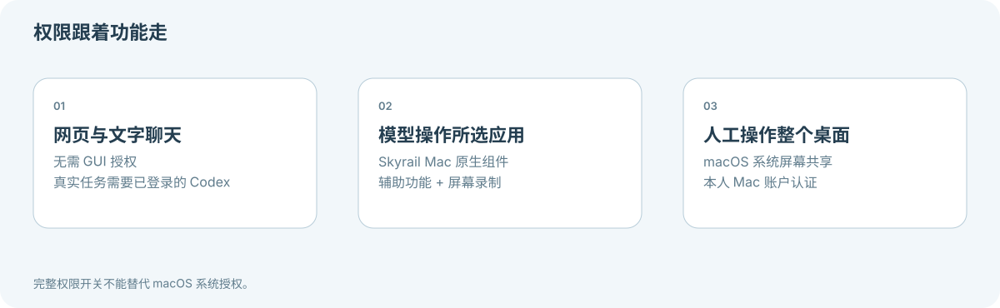

**[Skyrail](README.zh-CN.md) / [文档中心](docs/README.zh-CN.md)**

# 安全策略

[English](SECURITY.md) · [安装与权限](docs/GETTING-STARTED.zh-CN.md)

Skyrail 目前处于 0.x 早期阶段，仅对当前 main 接收修复；没有已审计的稳定版本或商业支持承诺。

请勿在公共 Issue 披露可利用细节、远程密码、Cookie、token、聊天或桌面内容。发现漏洞时优先使用仓库 Security 页的 “Report a vulnerability”（若已启用）；入口不可用时先创建不含利用细节的 Issue，请维护者提供私下联系渠道。

## 信任边界

- 交给 Codex 时保留 RFB 连接，服务端按协议消息边界阻断人工按键、指针、剪贴板与改屏操作，同时放行画面请求；未完成的包不能跨交接边界执行，已按下的键鼠先释放。恢复人工输入前，先撤销模型窗口连接并等待交接完成。
- RFB 过滤器只解析握手和客户端消息边界，不解析屏幕图像或重建输入文本。支持当前 Mac 使用的 ARD、标准 VNC 与无认证测试握手；未知认证 / 扩展及超限消息关闭连接。

- Skyrail 操作真实 Mac。授予系统权限是由本人完成的独立步骤。
- 人工全桌面独立于模型窗口工具，连接固定指向本机系统屏幕共享，不接受远程主机或端口。整个物理桌面均在共享范围内。
- 人工控制台的图像、账户认证和键盘输入不进入聊天、模型工具与 session 记录；不提供此通道的截图、剪贴板同步和输入重放。浏览器只在当前连接内持有认证信息，断开后清除引用；不承诺 JavaScript 内存的可验证擦除。
- 外网 WebSocket upgrade 单独校验访问 Cookie、严格 Origin / Host 和固定路径；本地额外校验会话 Cookie 与随机控制票据。票据放在子协议中，不放在 URL 或日志。人工通道独占，12 秒心跳续约，90 秒失联及 24 小时上限关闭；系统账户认证仍由 macOS 检查。
- HTTPS 在你配置的代理终止（例如使用 Cloudflare 时由其终止），TLS 代理和本机转发进程均属于人工远控的信任边界；这不是独立端到端加密通道。系统屏幕共享服务的局域网访问范围需由部署者另行配置；项目不公开转发 TCP 5900。
- “允许全部操作”是本机 Skyrail 的持久权限开关，当前默认开启：会话 start / resume 使用 `approvalPolicy=never` 与 `sandbox=danger-full-access`，turn/start 同步使用 dangerFullAccess。允许访问运行账户可访问的文件、命令和网络；不是只读或隔离环境。仅作用于 Skyrail 子进程，不修改用户全局 Codex 配置。关闭后改为 workspace-write / on-request，并恢复应用操作审批。
- 关闭全局完整权限时，仍可选择“本次连接允许全部操作”，该授权仅限当前窗口连接；换应用或断开失效。
- Codex 自身 shell / MCP 配置不构成操作系统级隔离；开发者指令不是沙箱。
- 默认仅监听 loopback。公网访问需 HTTPS、认证网关和受控 tunnel；不要直接映射 4317。
- 网关为单用户共享密码，不是多用户身份或权限系统。Cookie 有效期 24 小时，重启失效。
- `.data/`、任务目录及凭据不得提交。公开仓库不意味着运行实例公开可用。

第三方依赖、Codex 和 Cloudflare 分别适用各自的许可证及服务条款；项目 MIT 许可不授予这些服务的使用权。

## 触屏输入适配

手势层将图像坐标映射到所选原生窗口或现有本地 RFB 通道，不扩大应用权限、不连接其他主机、不保存光标 / 按键 / 凭据负载。noVNC 1.7.0 私有指针编码隔离在 `desktop-rfb.mjs`，升级须重新执行合成 RFB 浏览器验收。隐藏视图禁用输入并隐藏远程光标；手势取消会先使排队输入失效，再释放按下的按钮，服务端租约始终为准。

## 文件传输

传输接口要求已有认证会话；上传还要求 CSRF 会话 token 与严格 Host / Origin 校验。上传流写入 `.data/files` 下各对话独立私有目录，限制 50 MiB，以临时文件和原子完成提交；失败时清理自身半成品。文件名作为文字显示，下载使用 attachment 和 nosniff，传输接口不会执行文件。

项目下载限定在对话实际工作目录，上传限定在该对话上传根目录。拒绝绝对路径、父目录越界、指向根目录外的符号链接、非普通文件和跨对话附件。目标校验与最终 O_NOFOLLOW 减少意外越界，但不防御并发恶意的本地完整权限进程；完整权限下 Agent 已有主机权限。远程登录可读取项目文件，本项目面向单一所有者，不提供多用户隔离。

附件以本地路径提供给 Codex，并保留在会话元数据中。上传内容是任务数据，不授予额外操作权限。不要公开上传文件、工作区或会话记录。

## 结束占用的 Codex 连接

已认证的 Skyrail 所有者可以显式结束持有指定原生会话锁的 Codex app-server 进程。服务端根据该 UUID 的 writer 锁通过 lsof 确定 PID，不接受调用者提供任意 PID；校验同一系统 UID、Codex app-server 身份，以及 PID、启动时间和共享会话锁的新鲜指纹。界面在确认前显示受影响连接数。共享进程可能包含其他运行任务和桌面端当前聊天，会一起中断。仅发送 SIGTERM，不删除锁文件或历史。占用者或范围改变后必须重新检查，不结束无法识别或属于其他用户的进程。这属于单一所有者认证入口的信任边界。

本地文件诊断是普通命令，继承当前命令沙箱，不能授予 TCC 权限。超时只终止其自身的一次性 worker，文件名以 JSON 参数传入，不经 shell 求值，不增加 GUI 自动化或权限绕过。

## 图片对话

图片预览沿用登录会话、对话目录与路径校验，只按真实签名返回 PNG / JPEG / WebP / GIF，携带固定类型、nosniff、sandbox CSP 和 no-store。SVG / HTML 即使改名 PNG 也被拒绝。每张图片上限 20 MiB；不能信任浏览器提供的 MIME 或附件 mediaType。签名检查不等于完整图片解码安全边界，浏览器与 Codex 仍需处理这些栅格文件。

发送图片时，图像数据会作为原生视觉输入交给所配置的 Codex 模型；仅上传不会调用模型。预览不作为公共图床，不自动加载外部 Markdown 图片，也不把任意原生历史路径开放为文件接口。图片中的文字是任务数据，不是额外操作授权。

---

[返回文档中心](docs/README.zh-CN.md)
