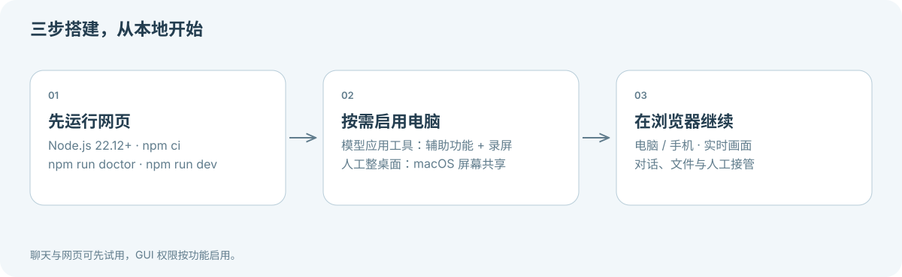

**[Skyrail](../README.zh-CN.md) / 文档中心**

# 找到你的下一步

[English](README.md) · 简体中文

Skyrail 是基于本地 Codex 的浏览器流式 Computer Use 工作台，在自己的 Mac 上搭建 Dot / Grok bot / Hark 风格的体验。

从本地试用开始，再按需启用电脑权限与远程访问。

> [!TIP]
> 网页试用、测试和构建不需要 macOS GUI 权限。真实纯文字任务只需要本人已登录的 Codex CLI。

**[图解认识 Skyrail →](VISUAL-GUIDE.zh-CN.md)**

## 从这里开始

| 你想做什么 | 对应指南 |
| --- | --- |
| 第一次运行 Skyrail | **[安装与本地测试](GETTING-STARTED.zh-CN.md)** — 环境要求、第一次聊天与分阶段验收 |
| 弄清楚需要哪些权限 | [权限指南](GETTING-STARTED.zh-CN.md#4-构建原生功能) — 模型操作应用与人工桌面独立授权 |
| 在另一台设备连接 Mac | **[远程访问与运维](REMOTE-ACCESS.zh-CN.md)** — 网关、HTTPS、后台运行与更新 |
| 排查错误 | [故障排查](../SUPPORT.zh-CN.md) — 安装、输入、画面、会话与文件 |

## 了解实际边界

- **[安全策略](../SECURITY.zh-CN.md)** — 完整权限、远程认证与文件传输范围。
- **[本次本地验收](LOCAL-VALIDATION-2026-11-03.md)** — 新工作区已通过什么、还有哪些未验收。
- **[历史验证记录](VALIDATION.md)** — 按时间记录的部署与设备证据及局限。
- **[人工解锁验收](REMOTE-UNLOCK.md)** — 真实桌面登录的前置条件与缺口。

## 参与开发与维护

| 面向贡献者 | 面向维护者 |
| --- | --- |
| [贡献指南](../CONTRIBUTING.zh-CN.md) | [main 保护与发布验收](MAINTAINERS.md) |
| [系统架构](ARCHITECTURE.md) | [运维与移除](REMOTE-ACCESS.zh-CN.md) |
| [设计方向](DESIGN.md) | [变更记录](../CHANGELOG.md) |
| [实施计划](PLAN.md) | [第三方声明](../THIRD-PARTY-NOTICES.md) |

架构和历史记录目前主要使用中文；安装、运维、支持、贡献与安全等用户指南提供成对中英文版本。

---

[返回 Skyrail](../README.zh-CN.md) · [反馈问题](https://github.com/eminentgu/skyrail/issues/new/choose)
