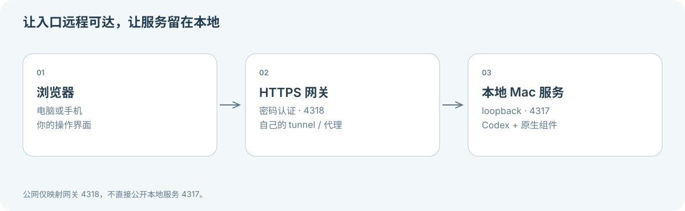

**[Skyrail](../README.zh-CN.md) / [文档中心](README.zh-CN.md)**

# 远程访问与运维

[English](REMOTE-ACCESS.md)

先完成[本地安装](GETTING-STARTED.zh-CN.md)。远程入口不能授予缺失的 macOS 权限，也不能让休眠中的电脑继续运行。



## 启动网关

本地服务监听 `127.0.0.1:4317`，在另一终端启动密码网关：

```sh
SKYRAIL_REMOTE_HOST=your.domain.example node apps/remote-gateway/server.mjs
```

使用自己的 HTTPS 域名和 tunnel，映射到 **127.0.0.1:4318**，不能映射 4317。tunnel 由你另行配置。首次启动生成仅限本地读取的 `.data/remote-access.txt`，不要发布其中内容。入口密码与 Mac 账户密码不同。登录 Cookie 在 24 小时后或网关重启后失效。该入口面向单用户，不提供租户或角色管理。

离开电脑前，先用另一台可信设备测试登录、聊天、文件传输和重连。桌面认证与手机真机键盘另行验收，不直接将开发服务暴露到公网。

## 可选：登录后后台运行

在 macOS 构建原生组件并配置所需权限后：

```sh
npm run build
SKYRAIL_REMOTE_HOST=your.domain.example CODEX_BIN=/absolute/path/to/codex npm run service:install
```

先停止前台开发服务。安装器创建或替换当前用户的 `local.skyrail.service` 和 `local.skyrail.gateway` 两个 LaunchAgent 并重启。它们在 macOS 登录后运行，不能在开机未登录或关机时提供服务。本地服务通过 `.data/Skyrail Mac.app` 启动以提供原生权限身份，使用固定的前端构建快照。安装会记录当前 Node 路径，更换路径后需重新安装服务。安装器不创建或修改 tunnel。

日志位于 `.data/local.skyrail.{service,gateway}.{out,err}.log`，可能含隐私信息，分享前脱敏。

## 更新

将 `.data/` 和 `workspaces/` 保持私有，升级前安全备份状态。使用下方命令停止任务；在工作区干净的 main 分支执行 `git pull --ff-only`，再运行 `npm ci` 和 `npm run build`。只有原生代码变化时才重编译原生组件，临时签名变化可能要求重新授权。运行测试和 `npm run doctor` 后，带域名与 Codex 路径重新运行安装器，刷新浏览器加载新构建。不要覆盖未提交的工作。

## 停止与取消后台启动

```sh
launchctl bootout gui/$(id -u)/local.skyrail.service
launchctl bootout gui/$(id -u)/local.skyrail.gateway
```

任务不存在时可能提示未加载。要取消下次登录启动，只删除这两个已安装文件：

- `~/Library/LaunchAgents/local.skyrail.service.plist`
- `~/Library/LaunchAgents/local.skyrail.gateway.plist`

如果配置过 tunnel，另行移除对应路由。停止 / 移除任务不会删除对话、上传文件、Codex 原生历史或系统隐私授权；按需分别保留或清理。


## 休眠、锁屏与控制权

任务 / 观看活动可保持系统运行，应用采集可能点亮物理显示器。`SKYRAIL_DISPLAY_MODE=headless` 禁止主动亮屏，需自行验证显示环境，不会创建虚拟屏幕。不能绕过强制休眠、关机与合盖限制。

锁屏会暂停应用采集 / 输入。桌面认证由本人在人工通道完成。发送任务暂停人工输入并保留串流，“接手操作”恢复输入，“断开连接”结束连接。Skyrail 租约不能隔离其他客户端或物理输入。

参见[故障排查](../SUPPORT.zh-CN.md)、[人工解锁验收](REMOTE-UNLOCK.md)和[安全边界](../SECURITY.md)。

---

[返回文档中心](README.zh-CN.md) · [需要帮助？故障排查 →](../SUPPORT.zh-CN.md)
