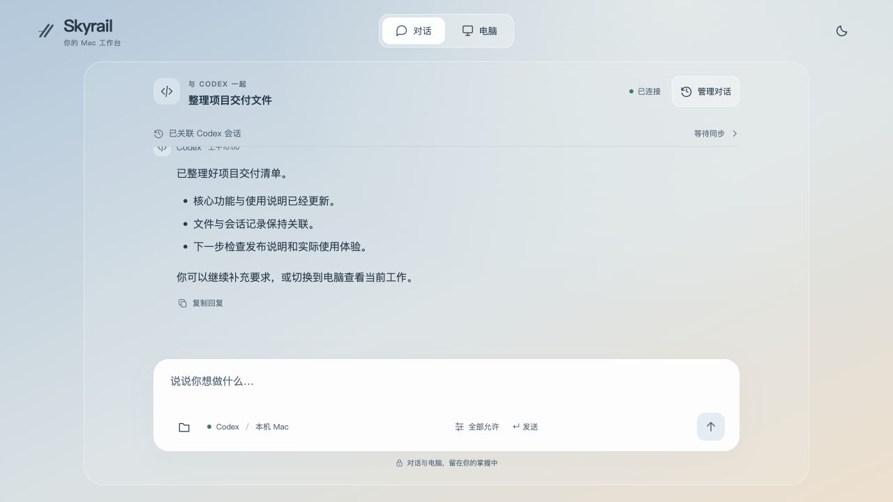
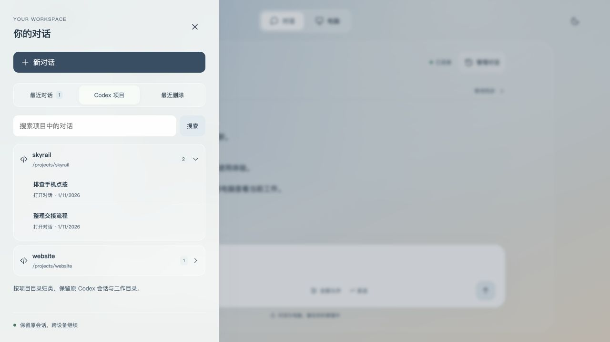
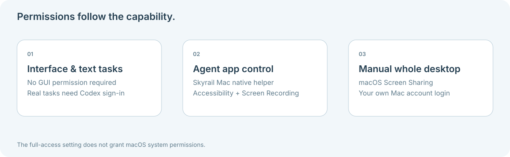
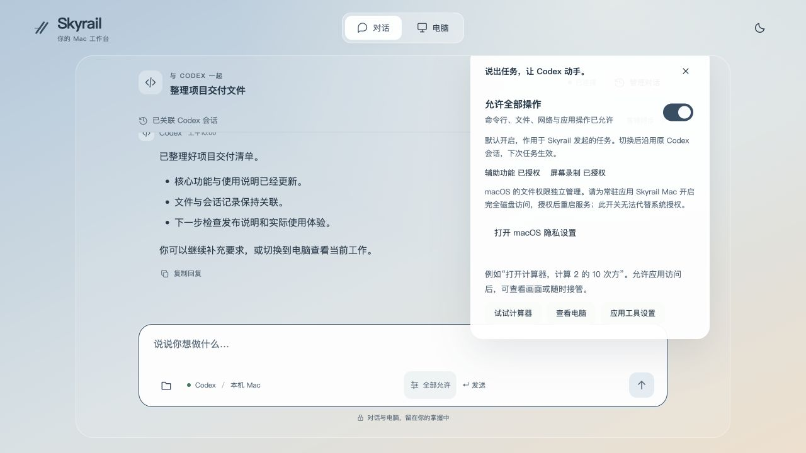
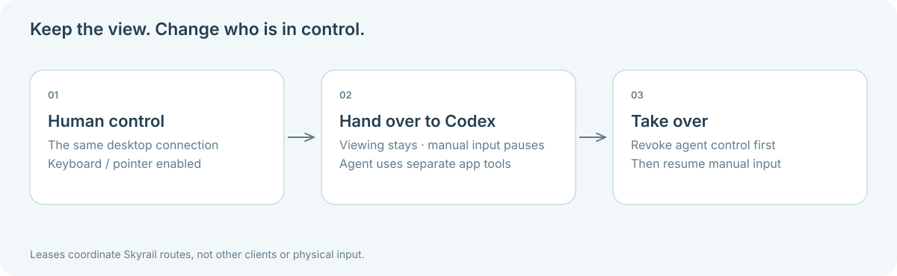
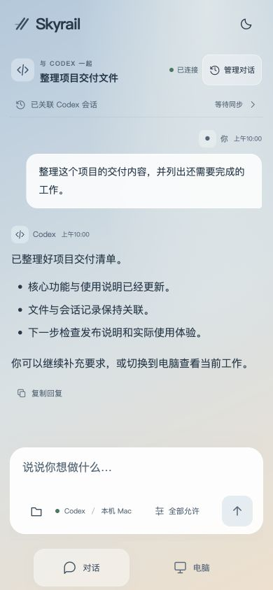
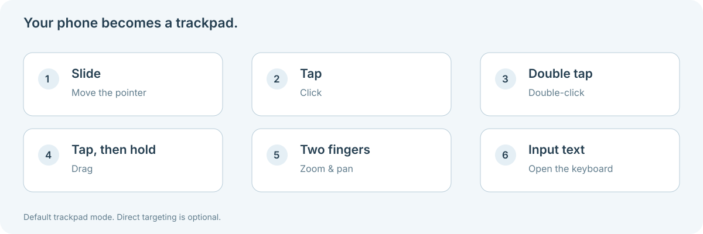
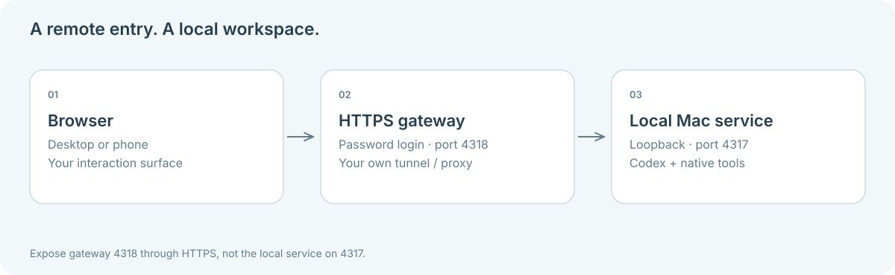

**[Skyrail](../README.md) / [Documentation](README.md)**

# A visual tour

[简体中文](VISUAL-GUIDE.zh-CN.md)

A conversation, a live computer view and your own Mac. This guide shows how the pieces fit together before you set up permissions.

> [!NOTE]
> Interface screenshots below use synthetic example data. They demonstrate the UI, not a completed model task, real device certification or live desktop acceptance. The current product interface is Chinese; the documentation is bilingual.

## 1. A conversation that continues

Open a Codex conversation and keep the message, results and working directory together. Type a task in the composer; use the folder button for files and the settings button for access choices.

The illustrated messages are examples. To test your own account, use a fresh conversation and a harmless request such as `Reply SKYRAIL_CHAT_OK without tools`.

## 2. Find the project, keep the session

**Manage conversations** opens recent Skyrail chats and native Codex sessions grouped by project. Opening an existing session retains its ID and working directory. Use clients alternately, with one writer per native session.

If a session is occupied, inspect its owner and affected connection count before explicitly ending the connection. Other work sharing that process may be interrupted. See [session recovery](../SUPPORT.md#a-synchronized-codex-session-cannot-continue).

## 3. Choose the capability, then the permission

The task's full-access setting and macOS privacy grants are separate. Start with chat, then add app control or Screen Sharing when you need them.

The settings entry shows task access alongside native permission status. The following screenshot is an interface example, not evidence that your machine has those grants.

## 4. Keep watching while control changes

Sending a task parks manual desktop input while retaining the connection. The model operates through a separate app tool path. **Take over** restores manual input after the model's control is revoked.

## 5. A browser-sized workspace

The mobile layout keeps conversation and computer navigation at the bottom. Open **Input text** when you need the keyboard. Use the default trackpad gestures, or choose direct targeting when appropriate.

This screenshot is browser viewport simulation. Check your own phone's keyboard, IME, orientation, gestures and reconnection separately.

## 6. Make the connection your own

Run the service on your Mac. For another device, put your authenticated gateway behind your own HTTPS tunnel. The browser is the view and interaction surface; the runtime and files remain on your Mac.

[Start local setup →](GETTING-STARTED.md) · [Set up remote access →](REMOTE-ACCESS.md)
