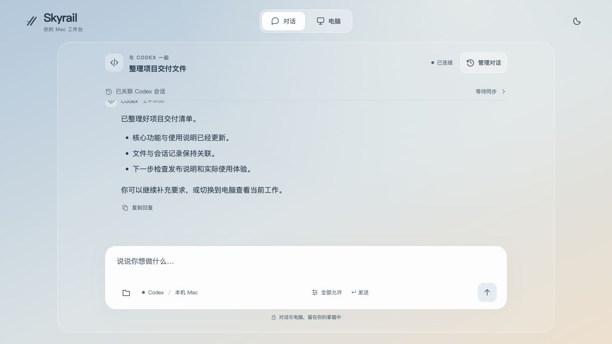
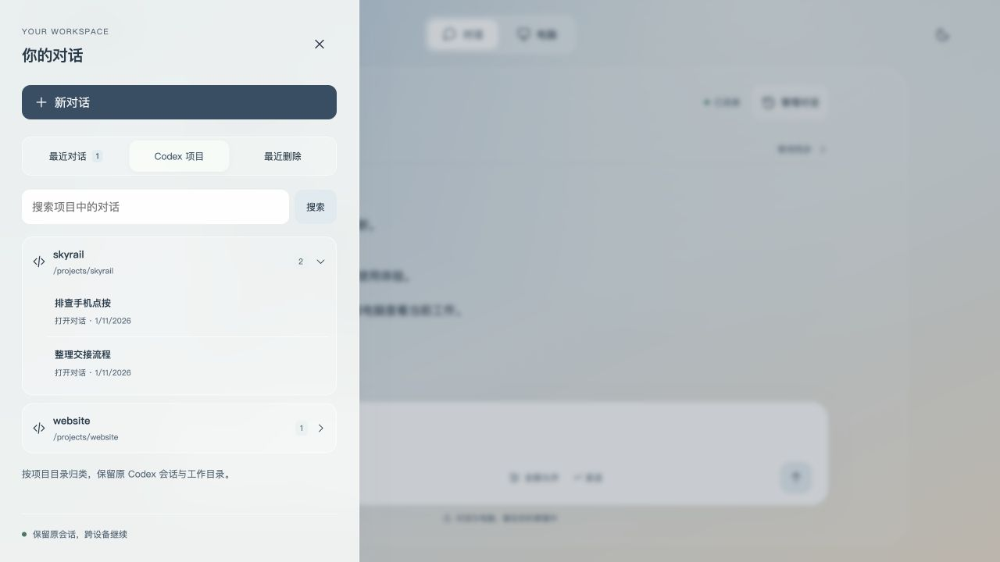
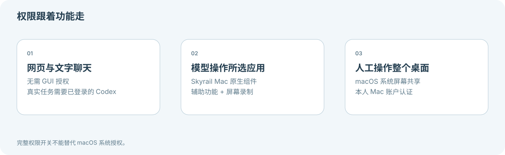
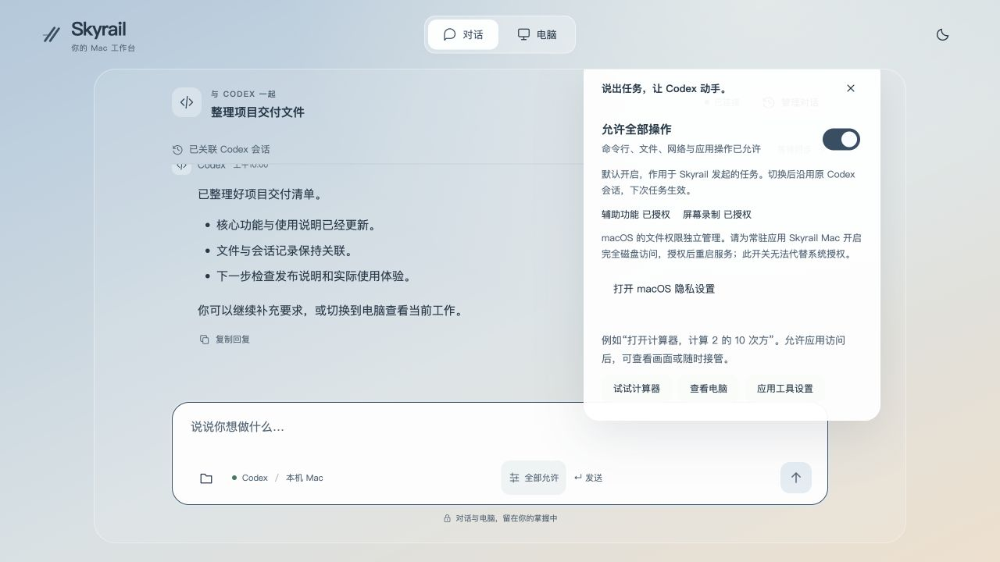
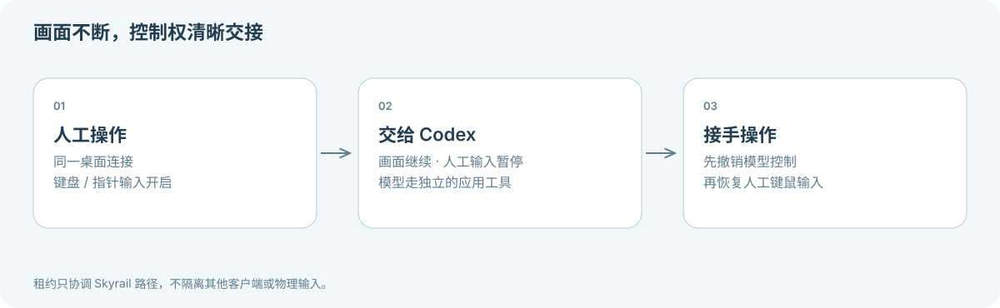
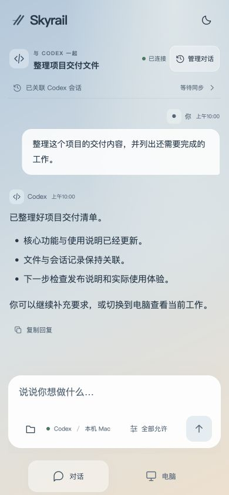
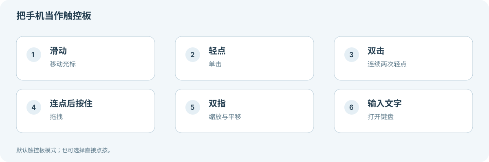
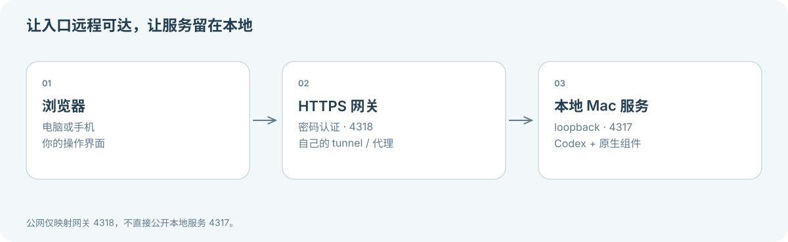

**[Skyrail](../README.zh-CN.md) / [文档中心](README.zh-CN.md)**

# 图解使用指南

[English](VISUAL-GUIDE.md)

一段对话，一个实时电脑视图，以及自己的 Mac。在设置权限之前，先用图片认识各部分如何配合。

> [!NOTE]
> 下方界面截图使用虚构示例数据，只演示界面，不代表真实模型任务、真机认证或桌面验收已通过。当前产品界面为中文，文档提供中英文。

## 1. 让一段对话继续下去

打开 Codex 对话，让消息、结果和工作目录留在一起。在输入框描述任务，用文件夹按钮传递文件，用设置按钮选择访问模式。

图中消息是示例。测试自己的账户时，请新建专用对话，发送“只回复 SKYRAIL_CHAT_OK，不调用工具”等无副作用请求。

## 2. 找到项目，沿用会话

“管理对话”提供最近的 Skyrail 对话，以及按项目分组的原生 Codex 会话。打开已有会话会保留原 ID 和工作目录。同一原生会话保持单一写入者，两端交替使用。

会话被占用时，先检查占用者和受影响连接数，再显式结束连接；共享该进程的其他任务也可能中断。参见[会话恢复](../SUPPORT.zh-CN.md#会话已同步另一端仍不能继续)。

## 3. 先选能力，再授予权限

任务的完整权限开关与 macOS 隐私授权是两件事。先测试聊天，再按需增加应用操作或屏幕共享。

设置入口把任务访问模式与原生权限状态放在一起。下图仅演示界面，不代表你的电脑已获得这些授权。

## 4. 画面保留，控制权交接

发送任务时暂停人工桌面输入，保留连接；模型通过独立的应用工具工作。“接手操作”会先撤销模型控制，再恢复人工输入。

## 5. 浏览器多大，工作台就多大

手机布局把对话与电脑导航放在底部。需要键盘时点“输入文字”。默认使用触控板手势，也可以按需切换直接点按。

截图来自浏览器尺寸模拟。请另行检查实际手机上的键盘、输入法、横竖屏、手势与重连。

## 6. 让连接属于自己

服务运行在自己的 Mac 上。其他设备通过密码网关和自己的 HTTPS tunnel 访问。浏览器提供画面与交互入口，运行时和文件留在本机。

[开始本地安装 →](GETTING-STARTED.zh-CN.md) · [配置远程访问 →](REMOTE-ACCESS.zh-CN.md)
